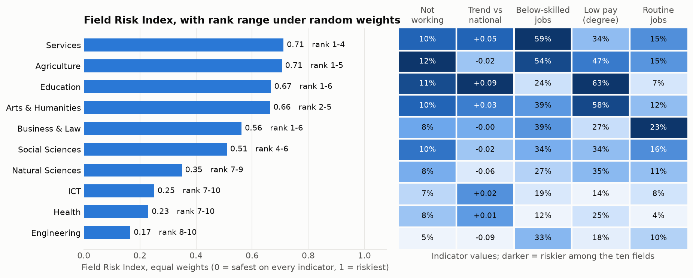
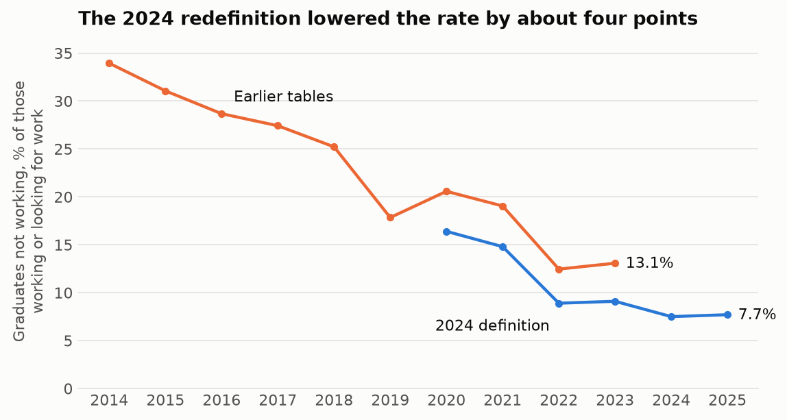
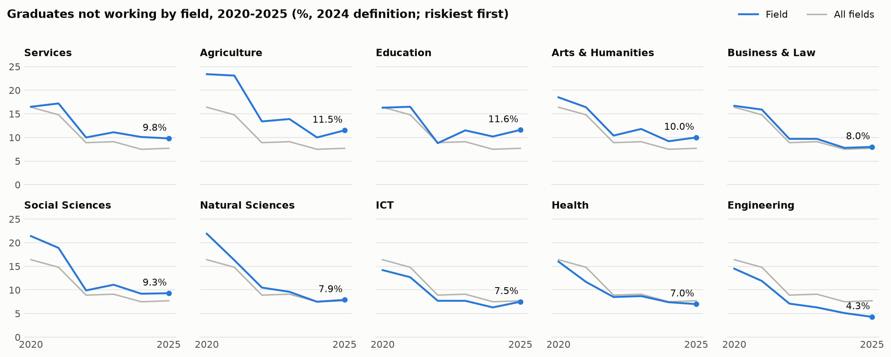
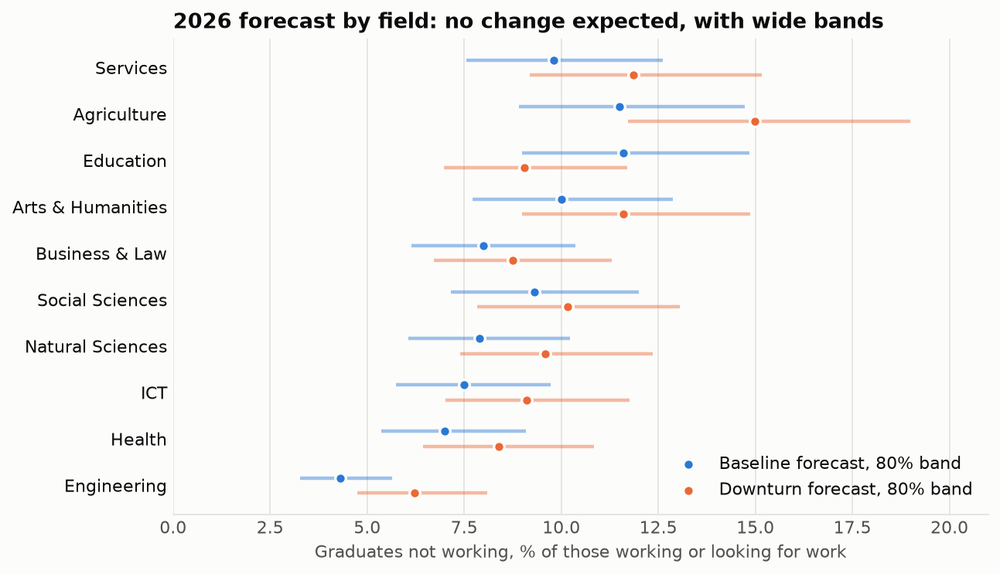

# Which fields of study leave Malaysian graduates most exposed?

A field-of-study risk index and short-range forecast built from the Ministry of Higher Education's Graduate Tracer Study, 2020-2025.

The project began as a plan to forecast which individual degree programmes would become "irrelevant" by 2030. The public data cannot support that: the Ministry publishes outcomes for ten broad fields of study, one figure per year, and nothing by programme. This repository does what the data does support, and says where it stops.

## Findings

1. **No field is close to failing.** In 2025 every field had at least 88% of its labour-force graduates in work. The government's stated review threshold (employability under 30%) is not approached by any field.
2. **Four fields sit at the risky end on most measures:** Services, Agriculture & Veterinary, Education, and Arts & Humanities. Which of them ranks first depends on the weights. Under 10,000 random weightings, the only other field that ever reaches the top three is Business & Law (25% of weightings).
3. **Three fields are consistently safest:** Engineering, Health, and ICT stay in the bottom four in at least 90% of the random weightings.
4. **The fields differ more in job quality than in finding work.** The not-working rate (2023-2025 average) spans 5% to 12% across fields. The share of employed graduates in jobs below skilled level spans 12% (Health) to 59% (Services), and the share of employed degree holders earning RM2,000 or less spans 14% (ICT) to 63% (Education).
5. **The best forecast is "no change".** With six yearly points per field, assuming next year equals this year beat every trend method on the current series. Forecasts to 2026-2027 are therefore flat with wide bands. A 2030 forecast would not be credible and is not given.
6. **A headline trap.** The Ministry changed its definition in 2024. Reading the published tables end to end shows the not-working rate falling from 13.1% (2023) to 7.5% (2024); on a like-for-like basis the fall was 9.1% to 7.5%.



## The definition change

Until 2023 the tracer tables counted every graduate who was not working, studying, training or waiting for a placement as "not working". From 2024 the Ministry aligned with the labour-force definition used by DOSM and the ILO: Graduate Employment (GE) is employed graduates as a share of graduates in the labour force, and graduates who are not looking for work are left out.

The Ministry's 2024 tracer report restates 2020-2023 on the new definition, by field (Table 8h). That gives a consistent six-year series, 2020-2025, which is what the index and forecasts use. The earlier tables (2014-2023) are kept as a separate series and never joined to it. Over the four years where both exist, the earlier tables run 3.6 to 4.3 points higher nationally.



## Data

All figures are for Malaysian citizens, all qualification levels from certificate to PhD, surveyed around graduation.

| File | Content | Source |
|---|---|---|
| `data/processed/ge_field.csv` | GE by field, 2020-2025 | SKPG 2024 report, Table 8h and Chart 8.2a; *Statistik Pendidikan Tinggi 2025*, Table 7.3 |
| `data/processed/jobs_field_2024.csv` | Occupation group of employed graduates by field, 2024 | SKPG 2024 report, Table 4k |
| `data/processed/pay_degree_2024.csv` | Monthly income of employed first-degree graduates by field, 2024 | SKPG 2024 report, Table 4o |
| `data/processed/tracer_field.csv` | Employment status counts by field, 2014-2025 (three field classifications) | *Statistik Pendidikan Tinggi* 2015-2025, chapter 7 |

Checks built into the parsers: every yearly status table sums to its printed total; every occupation and income row sums to 100; and the 2024 column of the report's trend table matches the 2024 statistics chapter to within 0.05 points for every field.

## The Field Risk Index

Five indicators, each oriented so that higher means more risk, rescaled so the safest field scores 0 and the riskiest 1, then averaged with adjustable weights.

| Indicator | Definition | Brief's component |
|---|---|---|
| Not working | Not-working rate, 2023-2025 average | Employability |
| Trend | Yearly change in the field's gap to the national rate (logit scale), 2020-2025 | Demand trend |
| Below-skilled jobs | Employed graduates outside managerial, professional and technician occupations (MASCO groups 4-9), 2024 | Mismatch |
| Low pay | Employed first-degree holders earning RM2,000 a month or less, 2024 | Mismatch |
| Routine jobs | Employed graduates in clerical or machine-operator occupations, 2024 | Automation (stand-in) |

| Rank | Field | Index | Rank range (5th-95th pct) | Not working | Below-skilled jobs | Low pay | Routine jobs |
|---|---|---|---|---|---|---|---|
| 1 | Services | 0.71 | 1-4 | 10.3% | 59% | 34% | 15% |
| 2 | Agriculture & Veterinary | 0.71 | 1-5 | 11.8% | 54% | 47% | 15% |
| 3 | Education | 0.67 | 1-6 | 11.1% | 24% | 63% | 7% |
| 4 | Arts & Humanities | 0.66 | 2-5 | 10.3% | 39% | 58% | 12% |
| 5 | Business, Administration & Law | 0.56 | 1-6 | 8.5% | 39% | 27% | 23% |
| 6 | Social Sciences, Journalism & Information | 0.51 | 4-6 | 9.9% | 34% | 34% | 16% |
| 7 | Natural Sciences, Maths & Statistics | 0.35 | 7-9 | 8.3% | 27% | 35% | 11% |
| 8 | ICT | 0.25 | 7-10 | 7.2% | 19% | 14% | 8% |
| 9 | Health & Welfare | 0.23 | 7-10 | 7.7% | 12% | 25% | 4% |
| 10 | Engineering, Manufacturing & Construction | 0.17 | 8-10 | 5.2% | 33% | 18% | 10% |

**How much the weights matter.** The rank range comes from 10,000 weightings drawn uniformly at random. The split between the top six and bottom four is stable; the order inside each group is not. Services and Agriculture are 0.006 apart and should be read as tied. Business & Law ranks 5th on equal weights but can reach 1st when the routine-jobs indicator dominates, because 22% of its employed graduates are in clerical work.

**PCA weights.** The first principal component explains 51% of the variance and loads positively on all five indicators (0.24 to 0.60), so a single "risk" dimension is a fair summary. Weighting by it moves Agriculture to 1st and Services to 3rd and changes no field by more than two places. With ten fields, these loadings are themselves imprecise.

## Forecasts



Five simple methods were compared by forecasting from every possible origin year and scoring one and two years ahead: last value, per-field drift, pooled drift, three-year mean, and exponential smoothing. All work on the logit of the rate.

| Method | Mean absolute error, current series 2020-2025 (points) | Earlier tables 2018-2023 (points) |
|---|---|---|
| Last value | 1.31 | 4.88 |
| Exponential smoothing | 1.59 | 5.39 |
| Per-field drift | 2.16 | 3.50 |
| Pooled drift | 2.20 | 3.41 |
| Three-year mean | 3.41 | 5.61 |

Last value wins on the series being forecast, so it is used. Drift methods win on the earlier tables only because that window is dominated by one long fall; extrapolating it forward would assume the post-pandemic recovery repeats every year. ARIMA and Prophet, named in the original plan, were not fitted: six observations cannot identify their parameters.

The band around each forecast is the 80th percentile of the method's absolute backtest error at the same horizon, pooled across fields and across both series. Including the earlier tables makes the band wider, because they contain the 2020 downturn and the 2022 recovery. The evidence behind it is thin: five forecast origins at one year ahead and four at two, and fields move together within a year, so the 54 and 36 errors are far from independent.

| Field | 2025 actual | 2026 forecast (80% band) | 2026 under a repeat of 2020 |
|---|---|---|---|
| Education | 11.6% | 11.6% (9.0-14.8) | 9.1% |
| Agriculture & Veterinary | 11.5% | 11.5% (8.9-14.7) | 15.0% |
| Arts & Humanities | 10.0% | 10.0% (7.7-12.9) | 11.6% |
| Services | 9.8% | 9.8% (7.6-12.6) | 11.9% |
| Social Sciences, Journalism & Information | 9.3% | 9.3% (7.2-12.0) | 10.2% |
| Business, Administration & Law | 8.0% | 8.0% (6.1-10.4) | 8.7% |
| Natural Sciences, Maths & Statistics | 7.9% | 7.9% (6.1-10.2) | 9.6% |
| ICT | 7.5% | 7.5% (5.8-9.7) | 9.1% |
| Health & Welfare | 7.0% | 7.0% (5.4-9.1) | 8.4% |
| Engineering, Manufacturing & Construction | 4.3% | 4.3% (3.3-5.6) | 6.2% |

**Downturn scenario.** Each field's 2019-to-2020 rise in the not-working rate is applied again. That rise is measured on the earlier eight-field tables, so ICT and Natural Sciences share one value, as do Business & Law and Social Sciences. Education's rate fell in 2020, so it improves under this scenario; that reflects one year's public-sector hiring and should not be read as protection in a future downturn.



## What the original plan asked for that is not here

| Planned | Status | Why |
|---|---|---|
| Programme-level index (Political Science, Philosophy, ...) | Not possible | Outcomes are published for ten fields only |
| Oversupply ratio (graduates per vacancy) | Dropped | No vacancy data by field of study |
| Automation risk per programme | Stand-in only | No public automation scores by field; the routine-jobs share is a proxy and overlaps with the below-skilled indicator (rank correlation 0.84) |
| ARIMA / Prophet forecasts to 2030 | Replaced | Six comparable yearly points per field |
| Train 2015-2020, test 2021-2025 | Replaced by rolling-origin backtest | That split straddles two field reclassifications and the definition change |
| AI-adoption and green-economy scenarios | Not done | Nothing in the data links fields to either; only the downturn scenario is data-based |
| The "Jobstreet 15" and similar lists | Not tested | They name programmes; the data speaks only to their parent fields |

## Other limits

- Outcomes are measured around graduation, not later in a career.
- A field pools certificates through PhDs. Engineering includes many technical-certificate holders for whom craft and operator jobs match the qualification, which inflates its below-skilled share (33%). The low-pay indicator avoids this by using first-degree holders only.
- Job and pay indicators are a single year (2024).
- Ranks are relative: the index says which fields are worst among these ten, not that any is in trouble.
- "Education" covers different institutions in different tables (see the footnotes in the source).

## Run it

```bash
python -m venv .venv
.venv/Scripts/pip install -r requirements.txt      # .venv/bin/pip on macOS/Linux

python scripts/fetch_mohe.py      # download the statistics chapters (about 13 MB)
python scripts/build_panel.py     # parse the yearly status tables
python scripts/build_ge.py        # download the SKPG 2024 report (30 MB) and parse its tables
python scripts/analyse.py         # index, backtest, forecasts -> results/
python scripts/make_figures.py    # figures/
python -m pytest tests
streamlit run app.py              # dashboard with adjustable weights
```

The processed tables are committed, so `analyse.py`, the tests and the dashboard run without the downloads.

A short policy note based on these results is in [`docs/policy_brief.md`](docs/policy_brief.md).
